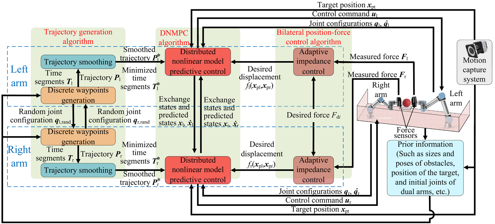
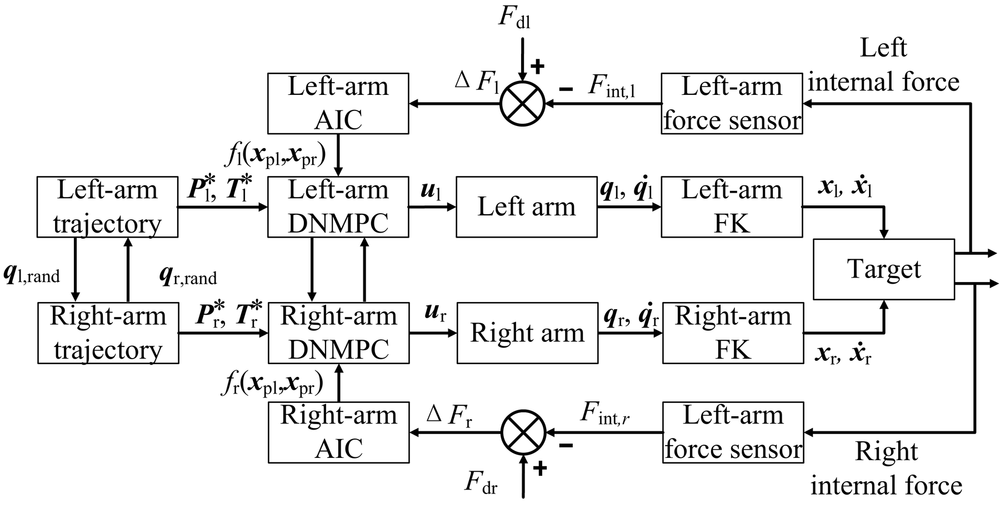
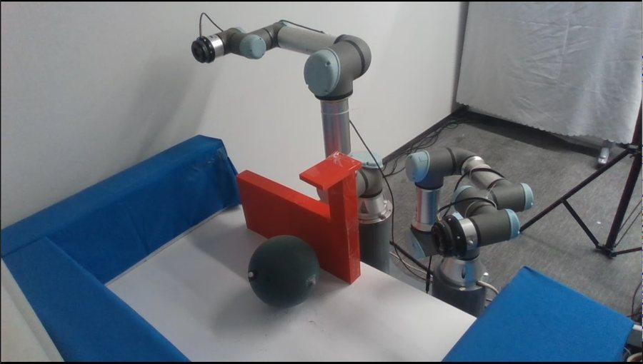
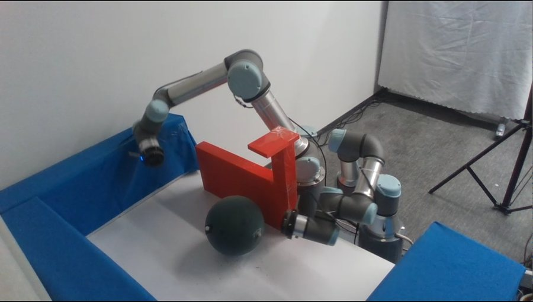
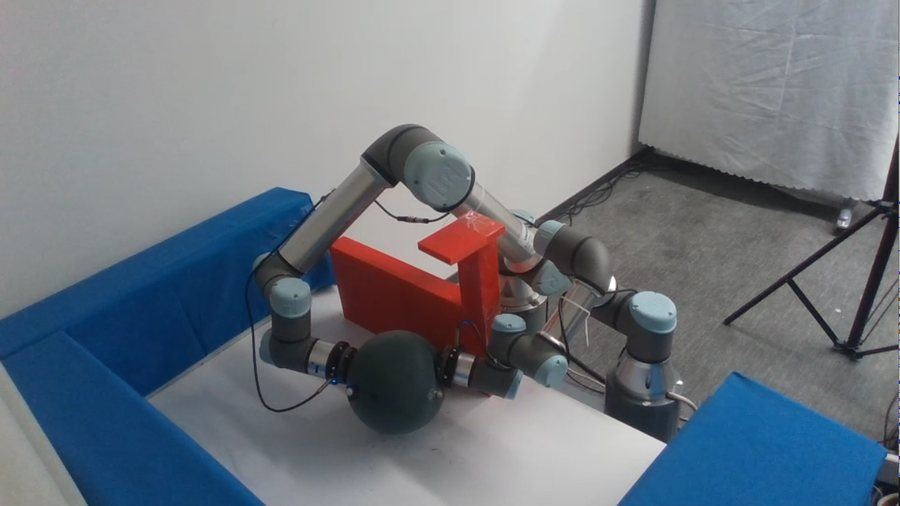
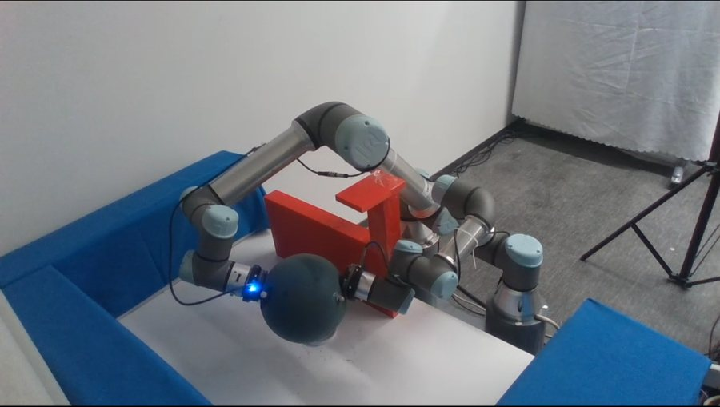
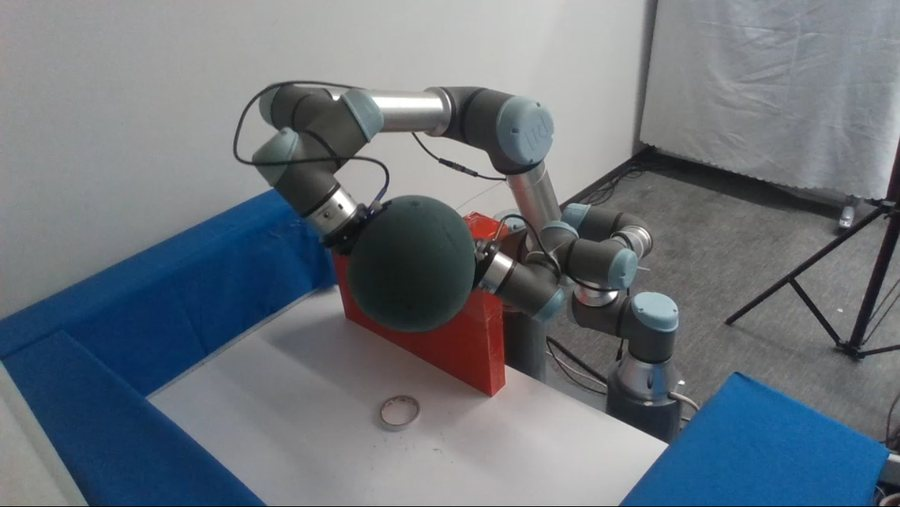
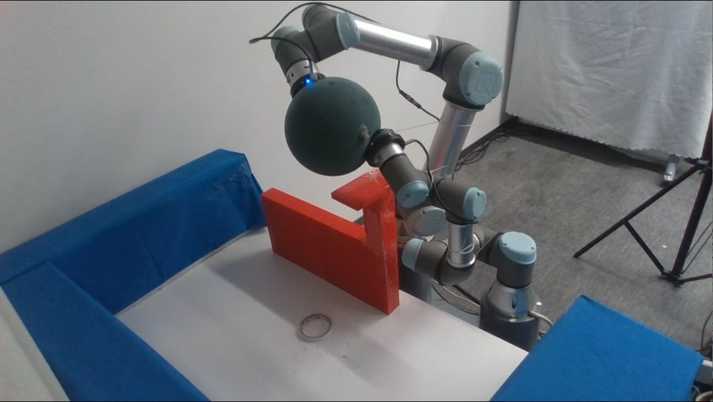

# Collaborative Manipulation with Dual Arms in Narrow Spaces

<strong>A visual project page for safe, coordinated dual-arm grasping and transport in constrained workspaces.</strong>

  

## Code snapshot

The initial CM workspace snapshot is in [`CM_ws/`](CM_ws/). See the [workspace guide](CM_ws/README_CN.md) and [snapshot scope and validation notes](CM_ws/SNAPSHOT_20260920.md) before running it.

## Overview

This work presents an integrated framework for dual-arm manipulation in narrow spaces. It combines rapid constrained trajectory generation, distributed nonlinear model predictive control (DNMPC), and bilateral position-force control with adaptive impedance. Simulation and real-world experiments cover grasping, transporting, placing, and pouring with rigid, soft, irregular, and deformable targets.

<!-- ### Main contributions

- A rapid trajectory-generation method that jointly satisfies collision-avoidance, kinematic, and task constraints while maintaining spatio-temporal consistency.
- A distributed NMPC controller that coordinates both arms through predicted-state exchange.
- A bilateral position-force controller with adaptive impedance for explicit internal-force regulation across targets with different stiffness. -->

**Keywords:** dual-arm system, trajectory generation, distributed nonlinear model predictive control, position-force control.

## Manipulation concept and kinematics

### Grasp and transport phases

  
  

### Coordinate system

  

## Algorithm design

### Trajectory generation

  

#### Constraints in grasping and transport

  
  

### Distributed nonlinear model predictive control

  

### Bilateral position-force control

  
  

#### Adaptive impedance and desired-force design

  
  
  

## Parameter settings and selection

Parameters are selected by balancing successful task completion, trajectory tracking, internal-force regulation, execution time, and computation time. The index $i\in\{\mathrm{l},\mathrm{r}\}$ denotes the left or right arm. The experiment settings below retain the values reported in the manuscript.

### Prediction horizon

The sampling period is $T_{\mathrm{s}}=20$ ms, corresponding to 50 Hz. The selected number of prediction steps is $N_{\mathrm{p}}=5$, giving a prediction horizon of $t_{\mathrm{d}}=N_{\mathrm{p}}T_{\mathrm{s}}=0.10$ s.

Increasing $N_{\mathrm{p}}$ from 2 to 5 reduces the reported force RMSE from 1.92 N to 1.88 N. Increasing it to 7 leaves that RMSE unchanged but raises mean computation time from 16.634 ms to 17.481 ms. At 10 steps, mean computation time reaches 25.811 ms and the deadline-miss rate is 22.55%. Five steps therefore provide the reported force-tracking performance with a 0% deadline-miss rate in the tested control cycles. Path generation and trajectory smoothing run offline; the online timing includes bilateral position-force control within DNMPC.

### Trajectory smoothing weights

The selected weights are:

| $w_{\mathrm{p}i}$ | $w_{\mathrm{u}i}$ | $w_{\mathrm{q}i}$ | $w_{\mathrm{v}i}$ | $w_{\mathrm{p}i,\mathrm{g}}$ | $w_{\mathrm{o}i,\mathrm{g}}$ | $w_{\mathrm{p}i,\mathrm{t}}$ | $w_{\mathrm{o}i,\mathrm{t}}$ | $w_{\mathrm{T}i}$ |
| --- | --- | --- | --- | --- | --- | --- | --- | --- |
| $10$ | $1$ | $1000$ | $1000$ | $1000$ | $1000$ | $1000$ | $1000$ | $1$ |

Selection compares zero, the selected value, and twice the selected value for one weight or weight pair at a time, keeping all other weights fixed. For paired weights, both are changed together.

- **Path cost, $w_{\mathrm{p}i}=10$.** Removing this weight increases the path cost by 2.45% during grasping and 0.96% during transporting. Doubling it gives only 0.22% and 0.18% further reductions, while grasping success falls from 100% to 95%.
- **Joint-velocity cost, $w_{\mathrm{u}i}=1$.** Removing this weight increases joint-velocity cost by 210.98% and 81.09% in the two phases. Doubling it gives smaller additional reductions of 3.12% and 5.61%, while execution time increases by 4.14% and 10.36%.
- **Transporting task weights, $w_{\mathrm{p}i,\mathrm{t}}=w_{\mathrm{o}i,\mathrm{t}}=1000$.** Removing these weights reduces transporting success to 85%; the selected values restore 100%, while doubling them gives no further success-rate improvement. The other constraint weights remain at their selected values of 1000.
- **Execution time, $w_{\mathrm{T}i}=1$.** Removing this weight increases execution time by 5.58% and 12.85% in the two phases. Doubling it shortens execution time by another 24.82% and 21.18%, but increases joint-velocity cost by 33.03% and 22.43% and reduces transporting success to 95%.

These comparisons use the same 20-input diagnostic set for each phase, rather than an independent random test set. Success denotes output feasibility, not numerical convergence. For transporting, the selected setting is feasible in 20/20 cases and numerically converges in 16/20 cases. Reported changes are means of per-input relative changes, retaining all outputs; path cost denotes $J_{\mathrm{p}}$, not geometric arc length. The selected weights balance the tested objectives and feasibility requirements.

### DNMPC weight matrices for the target ball

The weight matrices vary across the four manipulation stages. Here, $I_n$ is the $n$-dimensional identity matrix and $0_n$ is the $n\times n$ zero matrix.

| Phase | Stage | $W_{\mathrm{t}i}$ | $W_{\mathrm{F}i}$ | $W_{\mathrm{o}i}$ | $W_{\mathrm{q}i}$ | $W_{\mathrm{v}i}$ | $W_{\mathrm{d}i}$ | $W_{\mathrm{u}i}$ |
| --- | --- | --- | --- | --- | --- | --- | --- | --- |
| Grasping | 1 | $0_{3}$ | $0_{3}$ | $0_{3}$ | $10I_{6}$ | $5I_{6}$ | $0_{3}$ | $0.01I_{6}$ |
| Grasping | 2 | $0.5I_{3}$ | $I_{3}$ | $I_{3}$ | $0_{6}$ | $0_{6}$ | $0.1I_{3}$ | $0.01I_{6}$ |
| Transporting | 3 | $40I_{3}$ | $100I_{3}$ | $2I_{3}$ | $7.5I_{6}$ | $3I_{6}$ | $0_{3}$ | $0.02I_{6}$ |
| Transporting | 4 | $1.5I_{3}$ | $I_{3}$ | $I_{3}$ | $0_{6}$ | $0_{6}$ | $10I_{3}$ | $0.01I_{6}$ |

The Stage 3 comparison changes one weight at a time to zero or twice its selected value, holding the others fixed. The terminal-position weight remains $W_{\mathrm{d}i}=0_3$.

- **Relative-position tracking, $W_{\mathrm{t}i}=40I_3$.** The selected value includes relative-position tracking while retaining 100% success. Doubling it provides no further relative-position improvement and increases force RMSE by 2.92% and the total DNMPC objective by 1.81%.
- **Orientation coordination, $W_{\mathrm{o}i}=2I_3$.** Removing this term increases orientation RMSE by 19.64% and reduces success to 80%. Doubling it reduces orientation RMSE by 13.52%, but increases relative-position and force RMSE by 23.08% and 30.19% and reduces success to 70%.
- **Control-command cost, $W_{\mathrm{u}i}=0.02I_6$.** Removing this term increases command cost by 0.87%. Doubling it gives only a further 0.85% reduction, while joint and joint-velocity RMSE increase by 30.40% and 14.86%.
- **Joint tracking, $W_{\mathrm{q}i}=7.5I_6$.** Removing this term reduces success to 0% and increases joint RMSE by 101.52%. Doubling it reduces joint RMSE by 35.24%, but increases force RMSE by 29.61% and reduces success to 85%.
- **Joint-velocity tracking, $W_{\mathrm{v}i}=3I_6$.** Removing this term reduces success to 0% and increases joint-velocity RMSE by 771.54%. Doubling it reduces joint-velocity RMSE by 40.70%, but increases force RMSE by 19.78% and reduces success to 90%.
- **Internal-force regulation, $W_{\mathrm{F}i}=100I_3$.** Removing this term increases force RMSE by 650.64% and reduces success to 95%. Doubling it further reduces force RMSE by 14.44%, but increases joint-velocity RMSE by 71.29%.

The selected Stage 3 setting achieves 100% success in these comparisons. Larger weights can improve an individual objective while worsening other errors or task success, so selection balances tracking, coordination, force regulation, and command cost. Reductions in individual metrics from unsuccessful settings do not indicate better overall performance.

### Adaptive parameters

| Parameter | Selected value | Role in the comparison |
| --- | --- | --- |
| $w_{\mathrm{b}i}$ | 200 | Compared with 0 and 400 |
| $w_{\mathrm{k}i}$ | 10 | Compared with 0 and 20 |
| $k_{0i}$ | 500 | Held fixed |

Each setting uses 20 reference trajectories with five repetitions, giving 100 runs. One adaptive parameter is changed at a time, and zero settings are used only for ablation. Failed runs are retained.

For $w_{\mathrm{b}i}$, the zero setting retains 100% success and reduces force RMSE by 2.68%, but increases relative-position RMSE, joint-velocity RMSE, and command cost by 1.41%, 0.26%, and 0.05%. The selected value of 200 improves those motion-related quantities while retaining task success. Increasing it to 400 raises force RMSE by 2.41% and reduces success to 98% relative to the selected setting.

For $w_{\mathrm{k}i}$, setting it to zero reduces success to 0%, while the selected value of 10 achieves 100%. Increasing it to 20 reduces success to 7% and increases force RMSE by 30.77%. These results support the selected gains for the tested conditions. The baseline setpoint-force stabilization rate is 0%, so this comparison is parameter screening rather than final validation of force regulation.

### Real-world experiment parameters: target ball

| Parameter | Grasping | Transporting |
| --- | --- | --- |
| Safety margin (m) | $0.005$ | $0.04$ |
| Allowable orientation to the other arm, left arm (rad) | $0.318$ | $0.30$ |
| Allowable orientation to the other arm, right arm (rad) | $0.40$ | $0.35$ |
| Allowable orientation to the target, left arm (rad) | $0.25$ | $0.25$ |
| Allowable orientation to the target, right arm (rad) | $0.20$ | $0.21$ |

### Real-world experiment parameters: target box

| Parameter | Grasping | Transporting |
| --- | --- | --- |
| Safety margin (m) | $0.005$ | $0.03$ |
| Allowable orientation to the other arm, left arm (rad) | $0.318$ | $0.35$ |
| Allowable orientation to the other arm, right arm (rad) | $0.25$ | $0.318$ |
| Allowable orientation to the target, left arm (rad) | $\pi$ | $\pi$ |
| Allowable orientation to the target, right arm (rad) | $\pi$ | $\pi$ |

## Simulation

### Ball

  
  
  
  
  
  

### Box

  
  
  
  
  
  

## Experimental platform and procedure

  

### Four-stage manipulation procedure

  
  
  
  

## Real-world manipulation sequences

### Ball

  
  
  
  
  
  

### Ball sequence used in the response letter

  
  
  
  
  
  

### Box

  
  
  
  
  
  

### Basketball

  
  
  
  
  
  

### Foam frame

  
  
  
  
  
  

### Plush toy

  
  
  
  
  
  

### L-shaped wire mesh

  
  
  
  
  
  

### Clothes-filled bag

  
  
  
  
  
  

## Quantitative results

### Ball: distance, force, constraints, and position

  
  

  

  
  

  
  
  
  

  

  
  

### Box: distance, force, constraints, and position

  
  

  
  

  
  

  

  
  

### Internal-force results for additional targets

  
  
  
  
  

  

Foam-frame transporting-force statistics with AIC (N):

| EE | Desired force | Maximum | Minimum | Mean | RMSE |
|---|---:|---:|---:|---:|---:|
| L | 4.10 | 4.73 | 3.10 | 3.98 | 0.45 |
| R | 4.10 | 5.56 | 3.65 | 4.48 | 0.66 |

Statistics use the compensated force traces from the updated experiment.

## Fault-tolerance demonstration

### Left-arm interruption

  
  
  

### Right-arm interruption

  
  
  

### Failure cases

  
  

### Force response

  
  

## Additional tasks

### Placing a ball

  
  
  
  
  
  

### Pouring with a box

  
  
  
  
  
  

### Task definitions

  
  

### Force results

  
  

