# Collaborative Manipulation with Dual Arms in Narrow Spaces

<!-- <p align="center"><strong>A visual project page for safe, coordinated dual-arm grasping and transport in constrained workspaces.</strong></p> -->

**Installation and startup:** [Setup](#setup).

## Overview

This work presents an integrated framework for dual-arm manipulation in narrow spaces. It combines rapid constrained trajectory generation, distributed nonlinear model predictive control (DNMPC), and bilateral position-force control with adaptive impedance. Simulation and real-world experiments cover grasping, transporting, placing, and pouring with rigid, soft, irregular, and deformable targets.


<!-- ### Main contributions

- A rapid trajectory-generation method that jointly satisfies collision-avoidance, kinematic, and task constraints while maintaining spatio-temporal consistency.
- A distributed NMPC controller that coordinates both arms through predicted-state exchange.
- A bilateral position-force controller with adaptive impedance for explicit internal-force regulation across targets with different stiffness. -->

**Keywords:** dual-arm system, trajectory generation, distributed nonlinear model predictive control, position-force control.

## Manipulation concept and kinematics

### Grasp and transport phases
<p align="center">
  
  
</p>

### Coordinate system

<p align="center">
  
</p>

## Algorithm design

<p align="center">
  
</p>

### Trajectory generation

<p align="center">
  
</p>

#### Constraints in grasping and transport

<p align="center">
  
  
</p>

### Distributed nonlinear model predictive control

<p align="center">
  
</p>

### Bilateral position-force control

<p align="center">
  
  
</p>

#### Adaptive impedance and desired-force design

<p align="center">
  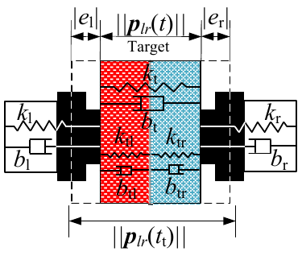
  
  
</p>

## Parameter settings and selection

Parameters are selected by balancing successful task completion, trajectory tracking, internal-force regulation, execution time, and computation time. The index $i\in\{\mathrm{l},\mathrm{r}\}$ denotes the left or right arm. The experiment settings below retain the values reported in the manuscript.

### Prediction horizon

The sampling period is $T_{\mathrm{s}}=20$ ms, corresponding to 50 Hz. The selected number of prediction steps is $N_{\mathrm{p}}=5$, giving a prediction horizon of $t_{\mathrm{d}}=N_{\mathrm{p}}T_{\mathrm{s}}=0.10$ s.

Increasing $N_{\mathrm{p}}$ from 2 to 5 reduces the reported force RMSE from 1.92 N to 1.88 N. Increasing it to 7 leaves that RMSE unchanged but raises mean computation time from 16.63 ms to 17.48 ms. At 10 steps, mean computation time reaches 25.81 ms and the deadline-miss rate is 22.55%. Five steps therefore provide the reported force-tracking performance with a 0% deadline-miss rate in the tested control cycles. Path generation and trajectory smoothing run offline; the online timing includes bilateral position-force control within DNMPC.

#### Comparison under different prediction horizons

| Algorithm | $N_{\mathrm{p}}$ | $t_{\mathrm{d}}$ (s) | $E_i$ | Force RMSE (N) | Mean computation time (ms) | Deadline miss (%) |
| --- | ---: | ---: | ---: | ---: | ---: | ---: |
| CNMPC | 2 | 0.04 | 0.09 | 1.63 | 16.67 | 0.20 |
| CNMPC | 5 | 0.10 | 0.09 | 1.61 | 18.67 | 1.05 |
| CNMPC | 7 | 0.14 | 0.09 | 1.61 | 19.87 | 5.30 |
| CNMPC | 10 | 0.20 | 0.09 | 1.60 | 21.55 | 48.70 |
| DNMPC without state exchange | 2 | 0.04 | 0.09 | 2.14 | 15.37 | 0.00 |
| DNMPC without state exchange | 5 | 0.10 | 0.08 | 2.37 | 16.69 | 0.00 |
| DNMPC without state exchange | 7 | 0.14 | 0.08 | 2.39 | 17.48 | 0.10 |
| DNMPC without state exchange | 10 | 0.20 | 0.08 | 2.39 | 25.49 | 30.20 |
| Ours | 2 | 0.04 | 0.09 | 1.92 | 15.33 | 0.00 |
| Ours | 5 | 0.10 | 0.08 | 1.88 | 16.63 | 0.00 |
| Ours | 7 | 0.14 | 0.08 | 1.88 | 17.48 | 0.00 |
| Ours | 10 | 0.20 | 0.08 | 1.88 | 25.81 | 22.55 |

### Trajectory smoothing weights

The selected weights are:

| $w_{\mathrm{p}i}$ | $w_{\mathrm{u}i}$ | $w_{\mathrm{q}i}$ | $w_{\mathrm{v}i}$ | $w_{\mathrm{p}i,\mathrm{g}}$ | $w_{\mathrm{o}i,\mathrm{g}}$ | $w_{\mathrm{p}i,\mathrm{t}}$ | $w_{\mathrm{o}i,\mathrm{t}}$ | $w_{\mathrm{T}i}$ |
| --- | --- | --- | --- | --- | --- | --- | --- | --- |
| $10$ | $1$ | $1000$ | $1000$ | $1000$ | $1000$ | $1000$ | $1000$ | $1$ |

Selection compares zero, the selected value, and twice the selected value for one weight or weight pair at a time, keeping all other weights fixed. For paired weights, both are changed together.

- **Path cost, $w_{\mathrm{p}i}=10$.** Removing this weight increases the path cost by 2.45% during grasping and 0.96% during transporting. Doubling it gives only 0.22% and 0.18% further reductions, while grasping success falls from 100% to 95%.
- **Joint-velocity cost, $w_{\mathrm{u}i}=1$.** Removing this weight increases joint-velocity cost by 210.98% and 81.09% in the two phases. Doubling it gives smaller additional reductions of 3.12% and 5.61%, while execution time increases by 4.14% and 10.36%.
- **Transporting task weights, $w_{\mathrm{p}i,\mathrm{t}}=w_{\mathrm{o}i,\mathrm{t}}=1000$.** Removing these weights reduces transporting success to 85%; the selected values restore 100%, while doubling them gives no further success-rate improvement. The other constraint weights remain at their selected values of 1000.
- **Execution time, $w_{\mathrm{T}i}=1$.** Removing this weight increases execution time by 5.58% and 12.85% in the two phases. Doubling it shortens execution time by another 24.82% and 21.18%, but increases joint-velocity cost by 33.03% and 22.43% and reduces transporting success to 95%.

These comparisons use the same 20-input diagnostic set for each phase, rather than an independent random test set. Success denotes output feasibility, not numerical convergence. For transporting, the selected setting is feasible in 20/20 cases and numerically converges in 16/20 cases. Reported changes are means of per-input relative changes, retaining all outputs; path cost denotes $J_{\mathrm{p}}$, not geometric arc length. The selected weights balance the tested objectives and feasibility requirements.

#### Effects of the trajectory smoothing weights in the grasping phase

| Weight setting | Success rate (%) | Path cost change (%) | Joint-velocity cost change (%) | Execution time change (%) | Optimization time change (%) |
| --- | ---: | ---: | ---: | ---: | ---: |
| $w_{\mathrm{p}i}=0$ | $100.00$ | $+2.45$ | $-0.43$ | $-0.01$ | $+1259.72$ |
| $w_{\mathrm{p}i}\times1$ | $100.00$ | $0.00$ | $0.00$ | $0.00$ | $0.00$ |
| $w_{\mathrm{p}i}\times2$ | $95.00$ | $-0.22$ | $+0.33$ | $+0.01$ | $-16.65$ |
| $w_{\mathrm{u}i}=0$ | $95.00$ | $-0.80$ | $+210.98$ | $-61.41$ | $+88920.47$ |
| $w_{\mathrm{u}i}\times1$ | $100.00$ | $0.00$ | $0.00$ | $0.00$ | $0.00$ |
| $w_{\mathrm{u}i}\times2$ | $100.00$ | $+0.25$ | $-3.12$ | $+4.14$ | $+23.43$ |
| $(w_{\mathrm{q}i},w_{\mathrm{v}i})=0$ | $100.00$ | $0.00$ | $0.00$ | $0.00$ | $-11.23$ |
| $(w_{\mathrm{q}i},w_{\mathrm{v}i})\times1$ | $100.00$ | $0.00$ | $0.00$ | $0.00$ | $0.00$ |
| $(w_{\mathrm{q}i},w_{\mathrm{v}i})\times2$ | $100.00$ | $0.00$ | $0.00$ | $0.00$ | $-2.99$ |
| $(w_{\mathrm{p}i,\mathrm{g}},w_{\mathrm{o}i,\mathrm{g}})=0$ | $100.00$ | $0.00$ | $0.00$ | $0.00$ | $-3.10$ |
| $(w_{\mathrm{p}i,\mathrm{g}},w_{\mathrm{o}i,\mathrm{g}})\times1$ | $100.00$ | $0.00$ | $0.00$ | $0.00$ | $0.00$ |
| $(w_{\mathrm{p}i,\mathrm{g}},w_{\mathrm{o}i,\mathrm{g}})\times2$ | $100.00$ | $0.00$ | $0.00$ | $0.00$ | $-1.28$ |
| $w_{\mathrm{T}i}=0$ | $100.00$ | $-0.01$ | $-3.58$ | $+5.58$ | $+7.01$ |
| $w_{\mathrm{T}i}\times1$ | $100.00$ | $0.00$ | $0.00$ | $0.00$ | $0.00$ |
| $w_{\mathrm{T}i}\times2$ | $100.00$ | $+0.09$ | $+33.03$ | $-24.82$ | $-38.93$ |

Success rates denote output feasibility, not numerical convergence. All $\times1$ rows share the same Full baseline on the same 20-input diagnostic set, which is not an independent random test set. Changes are means of per-input relative changes with respect to Full; all outputs, including infeasible outputs, are retained. Path cost denotes $J_{\mathrm{p}}$, not geometric arc length. For paired weights $(a,b)$, both weights are set to zero or doubled together; all other weights remain unchanged.

#### Effects of the trajectory smoothing weights in the transporting phase

| Weight setting | Success rate (%) | Path cost change (%) | Joint-velocity cost change (%) | Execution time change (%) | Optimization time change (%) |
| --- | ---: | ---: | ---: | ---: | ---: |
| $w_{\mathrm{p}i}=0$ | $95.00$ | $+0.96$ | $-1.62$ | $+0.72$ | $-37.12$ |
| $w_{\mathrm{p}i}\times1$ | $100.00$ | $0.00$ | $0.00$ | $0.00$ | $0.00$ |
| $w_{\mathrm{p}i}\times2$ | $100.00$ | $-0.18$ | $+1.19$ | $-0.01$ | $+26.82$ |
| $w_{\mathrm{u}i}=0$ | $90.00$ | $-0.44$ | $+81.09$ | $-23.18$ | $+2031.90$ |
| $w_{\mathrm{u}i}\times1$ | $100.00$ | $0.00$ | $0.00$ | $0.00$ | $0.00$ |
| $w_{\mathrm{u}i}\times2$ | $100.00$ | $+0.25$ | $-5.61$ | $+10.36$ | $+24.27$ |
| $(w_{\mathrm{q}i},w_{\mathrm{v}i})=0$ | $100.00$ | $0.00$ | $0.00$ | $0.00$ | $-20.16$ |
| $(w_{\mathrm{q}i},w_{\mathrm{v}i})\times1$ | $100.00$ | $0.00$ | $0.00$ | $0.00$ | $0.00$ |
| $(w_{\mathrm{q}i},w_{\mathrm{v}i})\times2$ | $100.00$ | $0.00$ | $0.00$ | $0.00$ | $-6.74$ |
| $(w_{\mathrm{p}i,\mathrm{t}},w_{\mathrm{o}i,\mathrm{t}})=0$ | $85.00$ | $0.00$ | $+0.02$ | $-0.03$ | $-43.34$ |
| $(w_{\mathrm{p}i,\mathrm{t}},w_{\mathrm{o}i,\mathrm{t}})\times1$ | $100.00$ | $0.00$ | $0.00$ | $0.00$ | $0.00$ |
| $(w_{\mathrm{p}i,\mathrm{t}},w_{\mathrm{o}i,\mathrm{t}})\times2$ | $100.00$ | $0.00$ | $+0.02$ | $-0.02$ | $+1.91$ |
| $w_{\mathrm{T}i}=0$ | $95.00$ | $+0.02$ | $-5.36$ | $+12.85$ | $+33.53$ |
| $w_{\mathrm{T}i}\times1$ | $100.00$ | $0.00$ | $0.00$ | $0.00$ | $0.00$ |
| $w_{\mathrm{T}i}\times2$ | $95.00$ | $+0.02$ | $+22.43$ | $-21.18$ | $+54.93$ |

Success rates denote output feasibility, not numerical convergence. All $\times1$ rows share the same Full baseline on the same 20-input diagnostic set, which is not an independent random test set. Full achieves feasibility in 20/20 cases and numerical convergence in 16/20 cases. Changes are means of per-input relative changes with respect to Full; all outputs, including infeasible or nonconverged outputs, are retained. Path cost denotes $J_{\mathrm{p}}$, not geometric arc length. For paired weights $(a,b)$, both weights are set to zero or doubled together; all other weights remain unchanged.

### DNMPC weight matrices for the target ball

The weight matrices vary across the four manipulation stages. Here, $I_n$ is the $n$-dimensional identity matrix and $0_n$ is the $n\times n$ zero matrix.

| Phase | Stage | $W_{\mathrm{t}i}$ | $W_{\mathrm{F}i}$ | $W_{\mathrm{o}i}$ | $W_{\mathrm{q}i}$ | $W_{\mathrm{v}i}$ | $W_{\mathrm{d}i}$ | $W_{\mathrm{u}i}$ |
| --- | --- | --- | --- | --- | --- | --- | --- | --- |
| Grasping | 1 | $0_{3}$ | $0_{3}$ | $0_{3}$ | $10I_{6}$ | $5I_{6}$ | $0_{3}$ | $0.01I_{6}$ |
| Grasping | 2 | $0.5I_{3}$ | $I_{3}$ | $I_{3}$ | $0_{6}$ | $0_{6}$ | $0.1I_{3}$ | $0.01I_{6}$ |
| Transporting | 3 | $40I_{3}$ | $100I_{3}$ | $2I_{3}$ | $7.5I_{6}$ | $3I_{6}$ | $0_{3}$ | $0.02I_{6}$ |
| Transporting | 4 | $1.5I_{3}$ | $I_{3}$ | $I_{3}$ | $0_{6}$ | $0_{6}$ | $10I_{3}$ | $0.01I_{6}$ |

The Stage 3 comparison changes one weight at a time to zero or twice its selected value, holding the others fixed. The terminal-position weight remains $W_{\mathrm{d}i}=0_3$.

- **Relative-position tracking, $W_{\mathrm{t}i}=40I_3$.** The selected value includes relative-position tracking while retaining 100% success. Doubling it provides no further relative-position improvement and increases force RMSE by 2.92% and the total DNMPC objective by 1.81%.
- **Orientation coordination, $W_{\mathrm{o}i}=2I_3$.** Removing this term increases orientation RMSE by 19.64% and reduces success to 80%. Doubling it reduces orientation RMSE by 13.52%, but increases relative-position and force RMSE by 23.08% and 30.19% and reduces success to 70%.
- **Control-command cost, $W_{\mathrm{u}i}=0.02I_6$.** Removing this term increases command cost by 0.87%. Doubling it gives only a further 0.85% reduction, while joint and joint-velocity RMSE increase by 30.40% and 14.86%.
- **Joint tracking, $W_{\mathrm{q}i}=7.5I_6$.** Removing this term reduces success to 0% and increases joint RMSE by 101.52%. Doubling it reduces joint RMSE by 35.24%, but increases force RMSE by 29.61% and reduces success to 85%.
- **Joint-velocity tracking, $W_{\mathrm{v}i}=3I_6$.** Removing this term reduces success to 0% and increases joint-velocity RMSE by 771.54%. Doubling it reduces joint-velocity RMSE by 40.70%, but increases force RMSE by 19.78% and reduces success to 90%.
- **Internal-force regulation, $W_{\mathrm{F}i}=100I_3$.** Removing this term increases force RMSE by 650.64% and reduces success to 95%. Doubling it further reduces force RMSE by 14.44%, but increases joint-velocity RMSE by 71.29%.

The selected Stage 3 setting achieves 100% success in these comparisons. Larger weights can improve an individual objective while worsening other errors or task success, so selection balances tracking, coordination, force regulation, and command cost. Reductions in individual metrics from unsuccessful settings do not indicate better overall performance.

#### Effects of the DNMPC objective weights in Stage 3

| Weight setting | Success rate (%) | Joint RMSE change (%) | Relative-position RMSE change (%) | Orientation RMSE change (%) | Joint-velocity RMSE change (%) | Force RMSE change (%) | Command cost change (%) | $E_i$ change (%) |
| --- | ---: | ---: | ---: | ---: | ---: | ---: | ---: | ---: |
| $W_{\mathrm{t}i}=0$ | $100.00$ | $+0.41$ | $+0.03$ | $-0.27$ | $+0.19$ | $-1.11$ | $+0.02$ | $-0.52$ |
| $W_{\mathrm{t}i}\times1$ | $100.00$ | $0.00$ | $0.00$ | $0.00$ | $0.00$ | $0.00$ | $0.00$ | $0.00$ |
| $W_{\mathrm{t}i}\times2$ | $100.00$ | $-0.25$ | $+0.04$ | $+0.27$ | $-0.12$ | $\mathbf{+2.92}$ | $-0.02$ | $\mathbf{+1.81}$ |
| $W_{\mathrm{o}i}=0$ | $80.00$ | $-0.95$ | $-13.58$ | $\mathbf{+19.64}$ | $-2.05$ | $-31.24$ | $+0.01$ | $-2.17$ |
| $W_{\mathrm{o}i}\times1$ | $100.00$ | $0.00$ | $0.00$ | $0.00$ | $0.00$ | $0.00$ | $0.00$ | $0.00$ |
| $W_{\mathrm{o}i}\times2$ | $70.00$ | $+2.10$ | $\mathbf{+23.08}$ | $-13.52$ | $+3.94$ | $\mathbf{+30.19}$ | $-0.01$ | $\mathbf{+4.01}$ |
| $W_{\mathrm{u}i}=0$ | $100.00$ | $-14.07$ | $+0.51$ | $-0.05$ | $-3.06$ | $-0.07$ | $+0.87$ | $-2.59$ |
| $W_{\mathrm{u}i}\times1$ | $100.00$ | $0.00$ | $0.00$ | $0.00$ | $0.00$ | $0.00$ | $0.00$ | $0.00$ |
| $W_{\mathrm{u}i}\times2$ | $100.00$ | $\mathbf{+30.40}$ | $-0.46$ | $+0.06$ | $\mathbf{+14.86}$ | $+0.08$ | $-0.85$ | $\mathbf{+7.57}$ |
| $W_{\mathrm{q}i}=0$ | $0.00$ | $\mathbf{+101.52}$ | $\mathbf{+44.10}$ | $-4.93$ | $+32.96$ | $-35.44$ | $-2.89$ | $\mathbf{+58.01}$ |
| $W_{\mathrm{q}i}\times1$ | $100.00$ | $0.00$ | $0.00$ | $0.00$ | $0.00$ | $0.00$ | $0.00$ | $0.00$ |
| $W_{\mathrm{q}i}\times2$ | $85.00$ | $-35.24$ | $-16.66$ | $+1.96$ | $-12.85$ | $\mathbf{+29.61}$ | $+1.24$ | $-4.98$ |
| $W_{\mathrm{v}i}=0$ | $0.00$ | $+66.07$ | $+26.37$ | $-20.52$ | $\mathbf{+771.54}$ | $-15.61$ | $-7.15$ | $\mathbf{+338.53}$ |
| $W_{\mathrm{v}i}\times1$ | $100.00$ | $0.00$ | $0.00$ | $0.00$ | $0.00$ | $0.00$ | $0.00$ | $0.00$ |
| $W_{\mathrm{v}i}\times2$ | $90.00$ | $-27.64$ | $-13.21$ | $+5.87$ | $-40.70$ | $\mathbf{+19.78}$ | $+1.95$ | $-5.14$ |
| $W_{\mathrm{F}i}=0$ | $95.00$ | $-10.33$ | $-19.27$ | $-5.57$ | $-24.26$ | $\mathbf{+650.64}$ | $-0.00$ | $\mathbf{+780.75}$ |
| $W_{\mathrm{F}i}\times1$ | $100.00$ | $0.00$ | $0.00$ | $0.00$ | $0.00$ | $0.00$ | $0.00$ | $0.00$ |
| $W_{\mathrm{F}i}\times2$ | $100.00$ | $+0.52$ | $+0.76$ | $+0.48$ | $\mathbf{+71.29}$ | $-14.44$ | $+0.04$ | $-3.51$ |

Success rates are absolute values, whereas all other entries denote changes relative to the corresponding $\times1$ setting. A negative change denotes a reduction in the corresponding error or cost. For unsuccessful settings, a reduction in an individual metric does not indicate better overall performance because the trajectory violates at least one hard success criterion.

### Adaptive parameters

| Parameter | Selected value | Role in the comparison |
| --- | --- | --- |
| $w_{\mathrm{b}i}$ | 200 | Compared with 0 and 400 |
| $w_{\mathrm{k}i}$ | 10 | Compared with 0 and 20 |
| $k_{0i}$ | 500 | Held fixed |

Each setting uses 20 reference trajectories with five repetitions, giving 100 runs. One adaptive parameter is changed at a time, and zero settings are used only for ablation. Failed runs are retained.

For $w_{\mathrm{b}i}$, the zero setting retains 100% success and reduces force RMSE by 2.68%, but increases relative-position RMSE, joint-velocity RMSE, and command cost by 1.41%, 0.26%, and 0.05%. The selected value of 200 improves those motion-related quantities while retaining task success. Increasing it to 400 raises force RMSE by 2.41% and reduces success to 98% relative to the selected setting.

For $w_{\mathrm{k}i}$, setting it to zero reduces success to 0%, while the selected value of 10 achieves 100%. Increasing it to 20 reduces success to 7% and increases force RMSE by 30.77%. These results support the selected gains for the tested conditions. The baseline setpoint-force stabilization rate is 0%, so this comparison is parameter screening rather than final validation of force regulation.

#### Effects of the adaptive parameters

| Parameter setting | Success rate (%) | Relative-position RMSE change (%) | Force RMSE change (%) | Joint-velocity RMSE change (%) | Control-command cost change (%) |
| --- | ---: | ---: | ---: | ---: | ---: |
| $w_{\mathrm{b}i}=0$ | $100.00$ | $+1.41$ | $-2.68$ | $+0.26$ | $+0.05$ |
| $w_{\mathrm{b}i}=200$ | $100.00$ | $0.00$ | $0.00$ | $0.00$ | $0.00$ |
| $w_{\mathrm{b}i}=400$ | $\mathbf{98.00}$ | $-1.14$ | $+2.41$ | $-0.19$ | $-0.03$ |
| $w_{\mathrm{k}i}=0$ | $\mathbf{0.00}$ | $+24.13$ | $-4.16$ | $+31.93$ | $+5.70$ |
| $w_{\mathrm{k}i}=10$ | $100.00$ | $0.00$ | $0.00$ | $0.00$ | $0.00$ |
| $w_{\mathrm{k}i}=20$ | $\mathbf{7.00}$ | $-10.35$ | $+30.77$ | $-1.41$ | $-0.26$ |

The baseline settings are $w_{\mathrm{b}i}=200$, $w_{\mathrm{k}i}=10$, and $k_{0i}=500$, where $i$ denotes the arm. One parameter is varied at a time, while the others remain fixed. Each setting uses $20$ reference trajectories with $5$ repetitions, giving $100$ runs. Success rates are absolute values, and the other columns report percentage changes relative to the corresponding baseline. Failed runs are retained. Zero settings are used only for ablation. Bold values indicate success rates below the baseline. The baseline setpoint-force stabilization rate is $0%$, so these comparisons are used for parameter screening rather than final validation of force regulation.

### Real-world experiment parameters: target ball

| Parameter | Grasping | Transporting |
| --- | --- | --- |
| Safety margin (m) | $0.005$ | $0.04$ |
| Allowable orientation to the other arm, left arm (rad) | $0.318$ | $0.30$ |
| Allowable orientation to the other arm, right arm (rad) | $0.40$ | $0.35$ |
| Allowable orientation to the target, left arm (rad) | $0.25$ | $0.25$ |
| Allowable orientation to the target, right arm (rad) | $0.20$ | $0.21$ |

### Real-world experiment parameters: target box

| Parameter | Grasping | Transporting |
| --- | --- | --- |
| Safety margin (m) | $0.005$ | $0.03$ |
| Allowable orientation to the other arm, left arm (rad) | $0.318$ | $0.35$ |
| Allowable orientation to the other arm, right arm (rad) | $0.25$ | $0.318$ |
| Allowable orientation to the target, left arm (rad) | $\pi$ | $\pi$ |
| Allowable orientation to the target, right arm (rad) | $\pi$ | $\pi$ |

## Simulation

### Ball

<p align="center">
  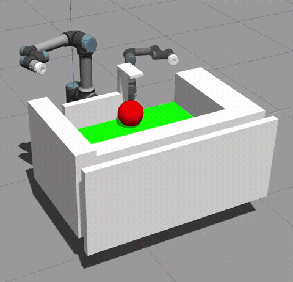
</p>

### Box

<p align="center">
  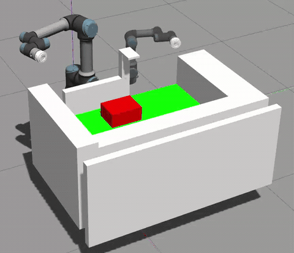
</p>

## Experimental platform and procedure

<p align="center">
  
</p>

### Four-stage manipulation procedure

<p align="center">
  
  
  
  
</p>

## Real-world manipulation sequences

### Ball

<table>
  <tr>
    <th align="center" width="50%">With AIC algorithm</th>
    <th align="center" width="50%">Without AIC algorithm</th>
  </tr>
  <tr>
    <td align="center"></td>
    <td align="center">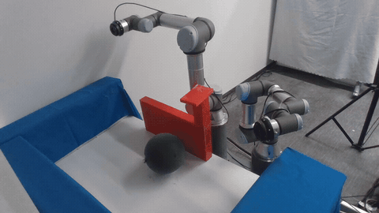</td>
  </tr>
</table>

### Box

<table>
  <tr>
    <th align="center" width="50%">With AIC algorithm</th>
    <th align="center" width="50%">Without AIC algorithm</th>
  </tr>
  <tr>
    <td align="center">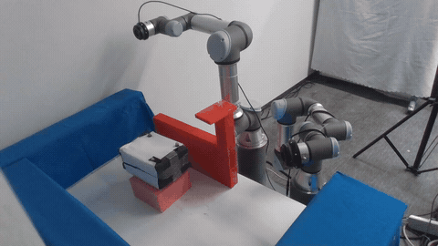</td>
    <td align="center">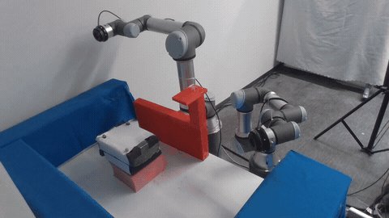</td>
  </tr>
</table>

### Basketball

<table>
  <tr>
    <th align="center" width="50%">With AIC algorithm</th>
    <th align="center" width="50%">Without AIC algorithm</th>
  </tr>
  <tr>
    <td align="center">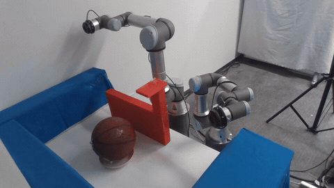</td>
    <td align="center">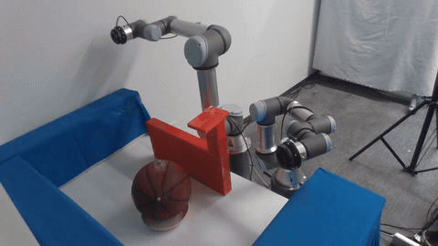</td>
  </tr>
</table>

### Foam frame

<table>
  <tr>
    <th align="center" width="50%">With AIC algorithm</th>
    <th align="center" width="50%">Without AIC algorithm</th>
  </tr>
  <tr>
    <td align="center">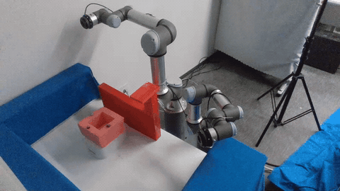</td>
    <td align="center">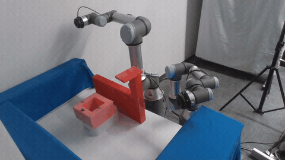</td>
  </tr>
</table>

### Plush toy

<table>
  <tr>
    <th align="center" width="50%">With AIC algorithm</th>
    <th align="center" width="50%">Without AIC algorithm</th>
  </tr>
  <tr>
    <td align="center">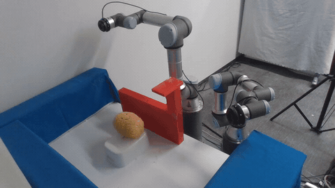</td>
    <td align="center">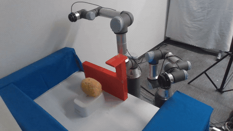</td>
  </tr>
</table>

### L-shaped wire mesh

<table>
  <tr>
    <th align="center" width="50%">With AIC algorithm</th>
    <th align="center" width="50%">Without AIC algorithm</th>
  </tr>
  <tr>
    <td align="center">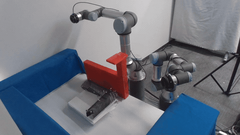</td>
    <td align="center">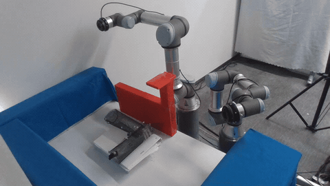</td>
  </tr>
</table>

### Clothes-filled bag

<table>
  <tr>
    <th align="center" width="50%">With AIC algorithm</th>
    <th align="center" width="50%">Without AIC algorithm</th>
  </tr>
  <tr>
    <td align="center">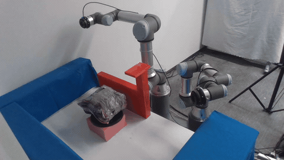</td>
    <td align="center"></td>
  </tr>
</table>

## Quantitative results

### Ball: distance, force, constraints, and position

<p align="center">
  
  
</p>

<p align="center">
  
</p>

<p align="center">
  
  
</p>

<p align="center">
  
  
  
  
</p>

<p align="center">
  
</p>

<p align="center">
  
  
</p>

### Box: distance, force, constraints, and position

<p align="center">
  
  
</p>

<p align="center">
  
  
</p>

<p align="center">
  
  
</p>

<p align="center">
  
</p>

<p align="center">
  
  
</p>

### Internal-force results for additional targets

<p align="center">
  
  
  
  
  
</p>

<p align="center">
  
</p>

## Ball transporting under controller fault conditions

### Left-controller fault

<table>
  <tr>
    <th align="center" width="50%">With the proposed DNMPC algorithm</th>
    <th align="center" width="50%">Without the proposed DNMPC algorithm</th>
  </tr>
  <tr>
    <td align="center"></td>
    <td align="center"></td>
  </tr>
</table>

### Right-controller fault

<table>
  <tr>
    <th align="center" width="50%">With the proposed DNMPC algorithm</th>
    <th align="center" width="50%">Without the proposed DNMPC algorithm</th>
  </tr>
  <tr>
    <td align="center">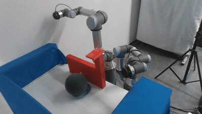</td>
    <td align="center">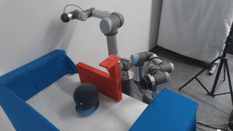</td>
  </tr>
</table>

### Force


<p align="center">
  
</p>

<p align="center">
  
</p>

## Additional tasks

### Placing the ball into a box

<table>
  <tr>
    <th align="center" width="50%">With AIC algorithm</th>
    <th align="center" width="50%">Without AIC algorithm</th>
  </tr>
  <tr>
    <td align="center">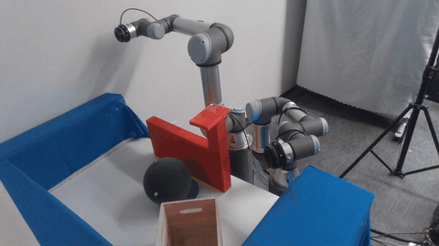</td>
    <td align="center">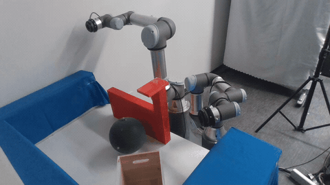</td>
  </tr>
</table>

### Pouring the contents from one box into another box

<table>
  <tr>
    <th align="center" width="50%">With AIC algorithm</th>
    <th align="center" width="50%">Without AIC algorithm</th>
  </tr>
  <tr>
    <td align="center">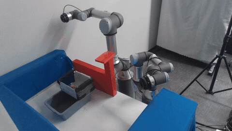</td>
    <td align="center">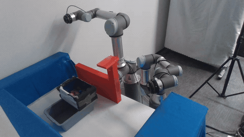</td>
  </tr>
</table>

### Task definitions

<p align="center">
  
  
</p>

### Force results

<p align="center">
  
  
</p>

## Setup

The development environment is **Ubuntu 20.04 LTS with ROS 1 Noetic and Python 3.8**. The ROS workspace is [CM_ws](CM_ws/). Run the commands below in Linux terminals.

### Prerequisites

- **Operating system:** Ubuntu 20.04 LTS (64-bit).
- **ROS:** ROS 1 Noetic with catkin; this workspace is not a ROS 2 package.
- **Simulation:** Gazebo Classic with ROS control plugins.
- **Python:** Python 3.8, NumPy, PyYAML and CasADi 3.6.3 with Ipopt.


Additional dependencies not covered by the commands above:

- **Planning:** Pinocchio and hpp-fcl development libraries, including their CMake package configurations. FCL and hpp-fcl are separate dependencies; both are required by this workspace.

- **Real-world experiments:** the UR ROS driver and robot-side External Control, as described below.

### Compiling

From the repository root:

```bash
source /opt/ros/noetic/setup.bash
cd CM_ws
export CM_WORKSPACE="$PWD"
catkin_make
source devel/setup.bash
```

Run the following in each new terminal, from `CM_ws`:

```bash
source /opt/ros/noetic/setup.bash
source devel/setup.bash
```

The current source layout is:

```text
CM_ws/src/
  simulation/
    cm_ball/
    cm_box/
  real_world_experiment/
    cm_dnmpc/
    cm_trajectory_generation/
    cm_trajectory_smoothing/
  asset/
    robotiq_ft_sensor/
    ur3_description/
    ur5_description/
```


### Quick start

Run these commands from `CM_ws` after building and sourcing it:

| Task | Command |
| --- | --- |
| Trajectory generation + smoothing: select simulation or a real-world object | `rosrun cm_trajectory_generation plan.py` |
| Ball: run the retained simulation | `roslaunch cm_ball sim.launch` |
| Box: run the retained simulation | `roslaunch cm_box sim.launch` |


### Trajectory generation and smoothing

After building and sourcing the workspace, run and select `simball`, `simbox`, or a real-world object (1–7):

```bash
rosrun cm_trajectory_generation plan.py
```

Each command runs planning **and smoothing** for the phases selected in `offline.yaml`. Simulation and real-world planning have separate entries and settings.

**Simulation**

| Target | Command |
| --- | --- |
| Ball | `rosrun cm_trajectory_generation plan.py simball` |
| Box | `rosrun cm_trajectory_generation plan.py simbox` |

**Real-world experiments**

| Number | Target | Command |
| --- | --- | --- |
| 1 | Ball | `rosrun cm_trajectory_generation plan.py ball` |
| 2 | Box | `rosrun cm_trajectory_generation plan.py box` |
| 3 | Basketball | `rosrun cm_trajectory_generation plan.py basketball` |
| 4 | Foam frame | `rosrun cm_trajectory_generation plan.py foam_frame` |
| 5 | Plush toy | `rosrun cm_trajectory_generation plan.py plush_toy` |
| 6 | L-shaped wire mesh | `rosrun cm_trajectory_generation plan.py l_shaped_wire_mesh` |
| 7 | Clothes-filled bag | `rosrun cm_trajectory_generation plan.py clothes_filled_bag` |


**Edit parameters here:** [offline.yaml](CM_ws/src/real_world_experiment/cm_trajectory_generation/config/offline.yaml).

<!-- | YAML field | Meaning |
| --- | --- |
| `planning.max_iterations`, `planning.timeout_s` | Planning iteration limit and timeout |
| `smoothing.max_iterations`, `smoothing.output_dt` | Optimization iteration limit and output sample interval |
| `objects.<name>.runtime` | `sim` for `simball`/`simbox`; `real` for the seven real-world objects |
| `objects.<name>.phases` | `[catch]`, `[move]`, or `[catch, move]`; simulation uses both |
| `sim_scenes` / `real_scenes` | Catch and Move scene YAML paths |
| `stage2_joints` | Real Move starting joints: 12 measured angles, left six then right six |
| `smoothing_overrides.catch` / `smoothing_overrides.move` | Override optimizer weights or steps for that phase |
| `output_root` | Output directory; each run gets a unique timestamp | -->

For example, to adjust the simulated Ball Move path weight:

```yaml
smoothing_overrides:
  catch: {}
  move:
    weight_path: 10.0
```


### Simulation: execution

Run one task at a time:

```bash
# Ball
roslaunch cm_ball sim.launch
```

```bash
# Box
roslaunch cm_box sim.launch
```

Each launch starts Gazebo and both controllers. Gazebo starts paused; press **Play** after initialization. 


### Real-world experiments: UR drivers

Single-arm launch files are in `cm_dnmpc/launch`. They depend on the existing `ur_robot_driver`, `ur_description` and `ur_client_library` installation, including the original `ur5e_controllers.yaml` and `ur3_controllers.yaml` driver configurations.

```bash
# UR5e: computer 192.168.1.80
roslaunch cm_dnmpc ur5e_urdriver.launch
```

```bash
# UR3: computer 192.168.1.90
roslaunch cm_dnmpc ur3_urdriver.launch
```

On the original robot computer, the same files are also installed under `ur_robot_driver/launch`, so `roslaunch ur_robot_driver ur5e_urdriver.launch` and `roslaunch ur_robot_driver ur3_urdriver.launch` are available. Use one entry per arm, not both package variants.

| Arm | Robot IP | Computer / reverse IP | Reverse port | Script sender | Trajectory | Script command |
| --- | --- | --- | ---: | ---: | ---: | ---: |
| UR5e / left | 192.168.1.100 | 192.168.1.80 | 50001 | 50002 | 50003 | 50004 |
| UR3 / right | 192.168.2.20 | 192.168.1.90 | 50005 | 50006 | 50007 | 50008 |

<!-- Robot IPs are retained from the original driver. UR3 needs a working route to `192.168.2.20`; its robot IP has not been guessed from the computer IP. Override `robot_ip:=...` and `reverse_ip:=...` if the hardware addresses differ. On each pendant, configure External Control with that arm's computer IP and **script sender** port, then start the program. Driver ports are separate from DNMPC's TCP ports 55005/55006.

The split preserves the existing driver controller settings and unprefixed joint names. The CM real controller currently expects prefixed joint names; resolve this interface mismatch before enabling CM motion. These changes have not been validated by moving hardware. -->

### Real-world experiments: FT300

Grant read/write permission to the actual local serial device before launching its sensor:

```bash
# UR5e
sudo chmod a+rw /dev/ttyUSB1
roslaunch robotiq_ft_sensor ur5e_ft300.launch serial_id:=ttyUSB1
```

```bash
# UR3
sudo chmod a+rw /dev/ttyUSB0
roslaunch robotiq_ft_sensor ur3_ft300.launch serial_id:=ttyUSB0
```

If the UR5e sensor is `ttyUSB0` on its computer, change both occurrences to `ttyUSB0`. Serial devices need read/write permission, not executable permission. Keep sensors unloaded and stationary during controller zero calibration.
